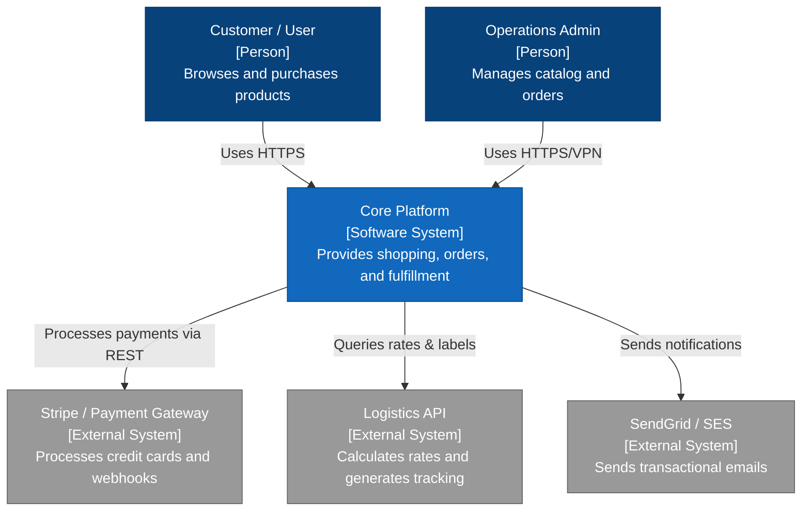
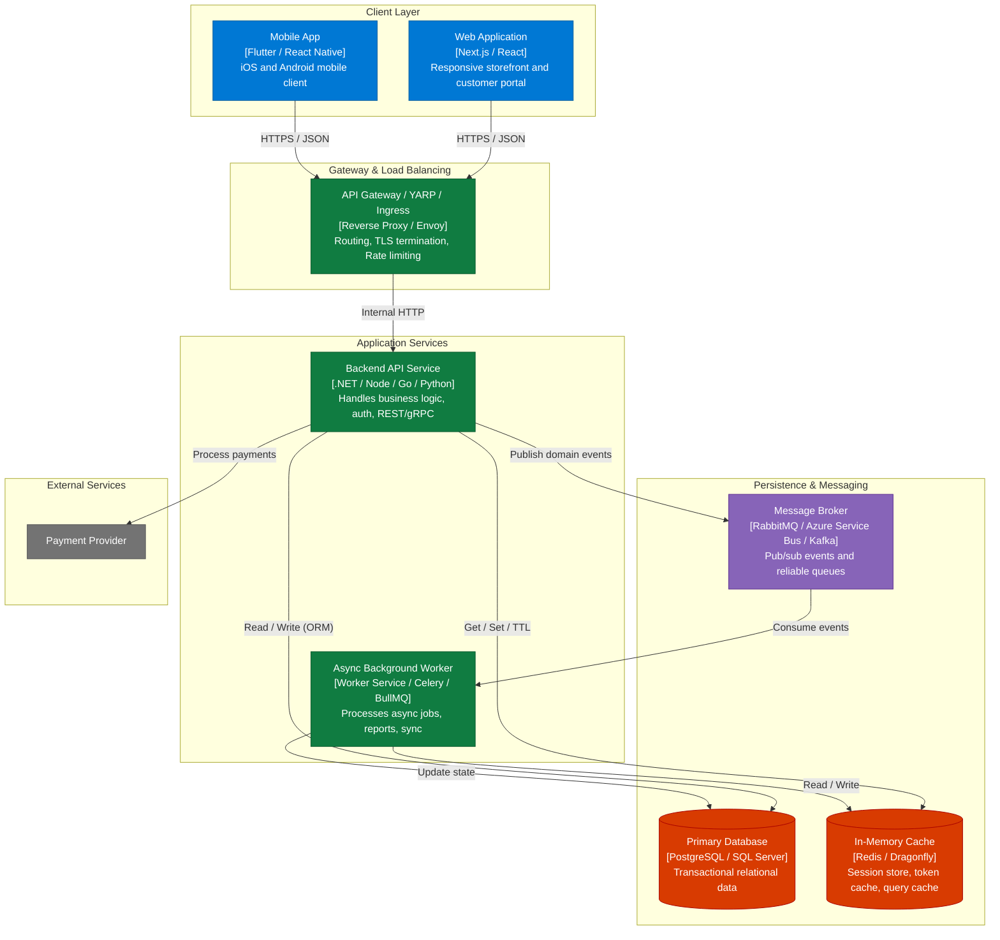
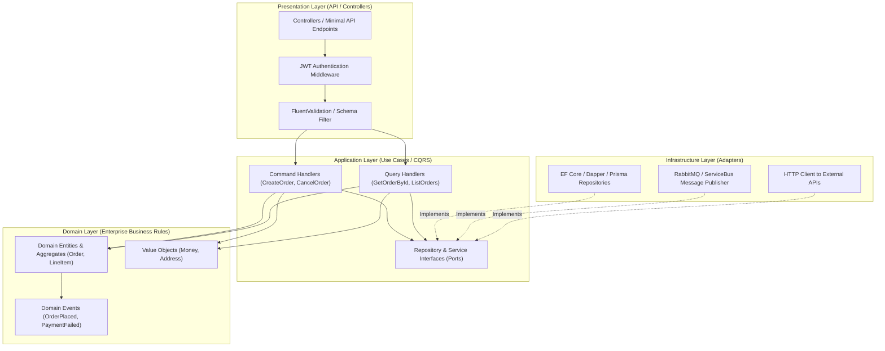
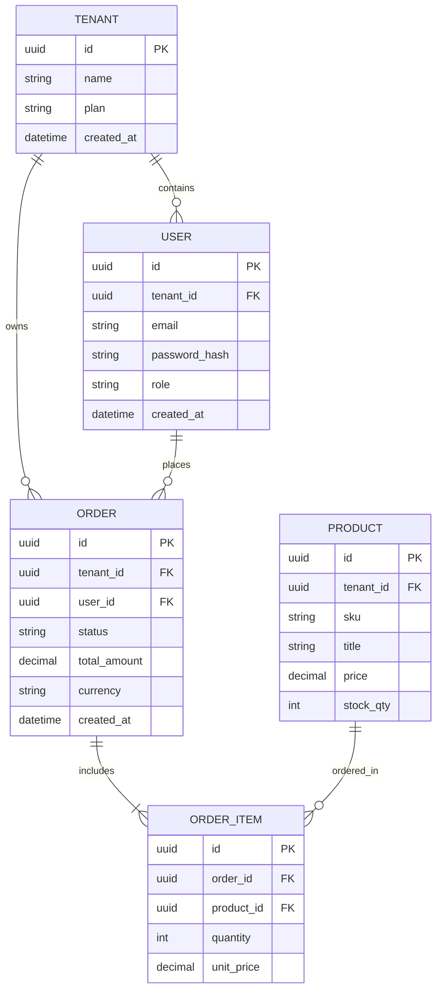
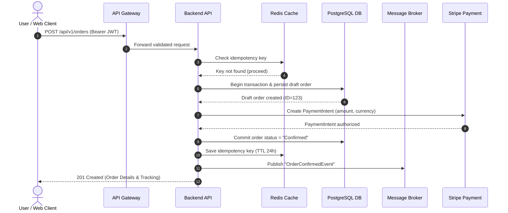
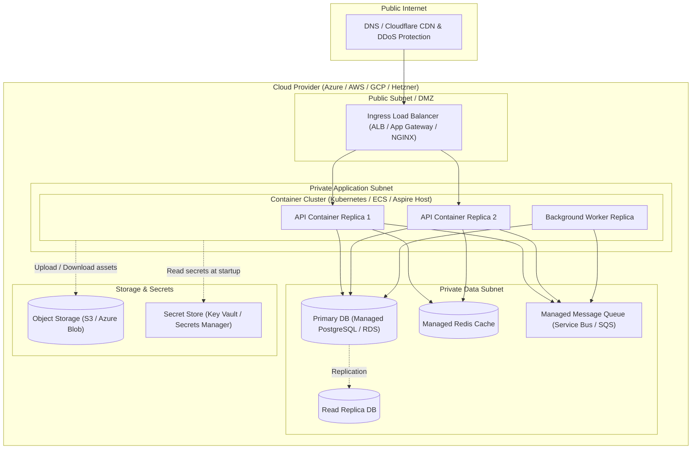

# C4 and Mermaid Diagram Patterns for Software Architecture

Mermaid diagrams must be clean, valid, and fully compatible with GitHub markdown rendering and IDE previews.
Always quote node labels that contain punctuation or parentheses, e.g., `id["Label (Description)"]`.

---

## 1. C4 Level 1: System Context Diagram
Shows the system in its environment, including human users and external systems.

---

## 2. C4 Level 2: Container Diagram
Decomposes the system into deployable units (Web apps, Mobile apps, APIs, Background Workers, Databases, Queues).

---

## 3. C4 Level 3: Component Diagram (Inside Backend API)
Breaks down the core service into logical layers (Clean / Hexagonal architecture).

---

## 4. Data Model: Entity-Relationship Diagram (ERD)

---

## 5. Core Dynamic Flow: Sequence Diagram

---

## 6. Infrastructure & Deployment Topology Diagram

