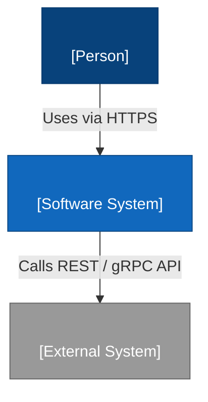
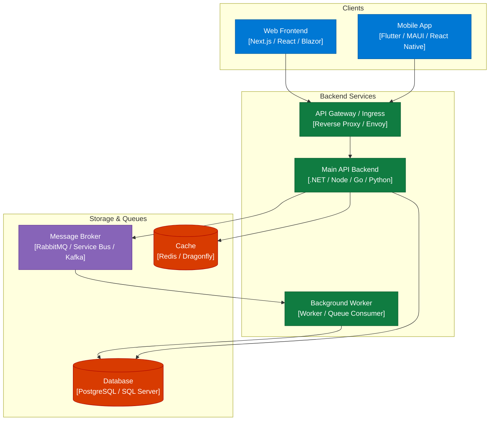
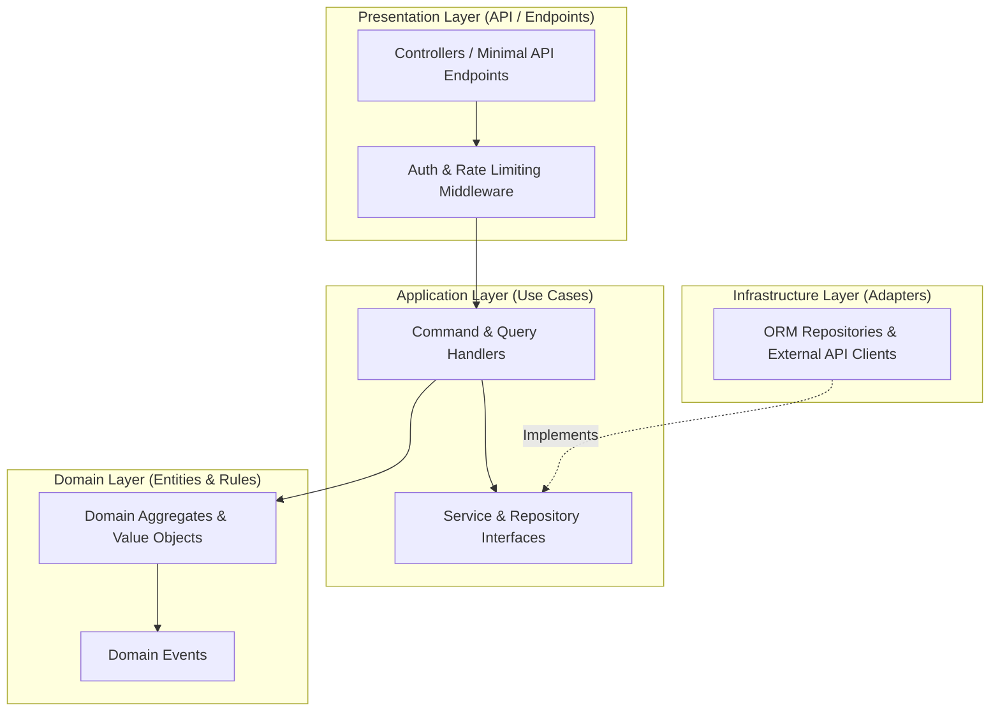
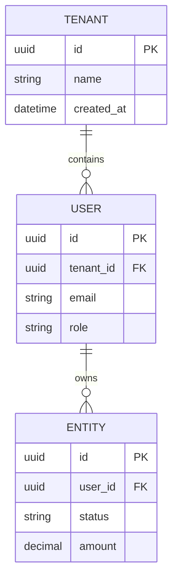
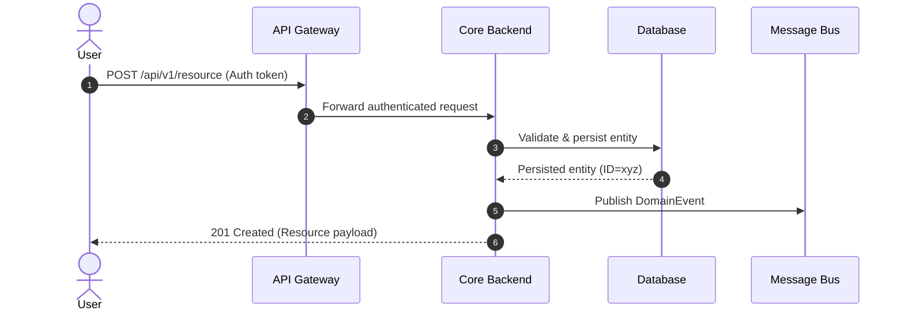
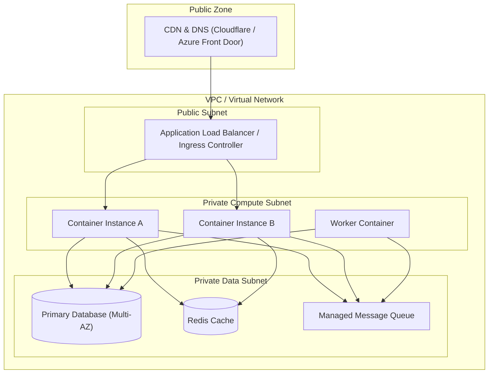

# System Architecture: <System Name>

Status: draft | confirmed        Confirmed by: <user> on <date>
Project: <System Name>          Target Scale: <e.g. 10k users, 500 req/sec>

---

## 1. Executive Summary & Problem Space
- **Business Goal**: <what problem this software solves and expected outcome>
- **Core Users & Stakeholders**: <actors interacting with the system>
- **Key Architectural Drivers**: <throughput, latency, availability 99.9%, security, compliance>

---

## 2. System Context (C4 Level 1)
Shows users, our system boundary, and external system integrations.

---

## 3. Container Architecture (C4 Level 2)
Deployable applications, databases, caches, and queues.

---

## 4. Component Architecture (C4 Level 3)
Layering and module decomposition inside the primary service.

---

## 5. Data Architecture & ERD
Entity relationships, keys, and storage partitioning.

---

## 6. Core Flow: Sequence Diagram
Step-by-step trace of the critical user interaction.

---

## 7. Infrastructure, Hosting & Cloud Topology
- **Cloud Provider**: <Azure | AWS | GCP | Hetzner | Vercel | Hybrid>
- **Container Strategy**: <.NET Aspire (Local dev) + Docker / Azure Container Apps / Kubernetes (Prod)>
- **Infrastructure as Code**: <Terraform / Bicep / Docker Compose>

---

## 8. Sizing, High Availability & Disaster Recovery
- **Target Scale**: <DAU, peak RPS, storage per month>
- **Compute Sizing**: <e.g. 2 instances, 1 vCPU, 2GB RAM with auto-scaling to 6>
- **Database Sizing**: <e.g. 2 vCPU, 8GB RAM, auto-growth storage>
- **High Availability**: <Multi-AZ redundancy, health-check probes>
- **Disaster Recovery**: <RPO: 5 min (PITR), RTO: 30 min, daily geo-replicated backups>

---

## 9. Security, Governance & Observability
- **Authentication & Authorization**: <OAuth2 / OIDC with JWT, RBAC / Claims>
- **Secrets Management**: <Azure Key Vault / AWS Secrets Manager / HashiCorp Vault>
- **Network Isolation**: <Private endpoints for DB and storage, zero public access to data tier>
- **Observability**: <OpenTelemetry SDK exporting traces and metrics to Prometheus/Grafana or AppInsights>

---

## 10. Architectural Decision Records (ADRs)
- **ADR-001**: <Decision, e.g., Choosing PostgreSQL over MongoDB, context and rationale>
- **ADR-002**: <Decision, e.g., Choosing Azure Container Apps + Aspire over full Kubernetes, context and rationale>

---

## 11. Initial MVP Implementation Modules
1. **Module 1**: <Core Auth & Tenant Onboarding> (`docs/specs/01-auth-tenants.md`)
2. **Module 2**: <Core Domain CRUD & Business Logic> (`docs/specs/02-core-domain.md`)
3. **Module 3**: <Async Worker & Integrations> (`docs/specs/03-workers-integrations.md`)
